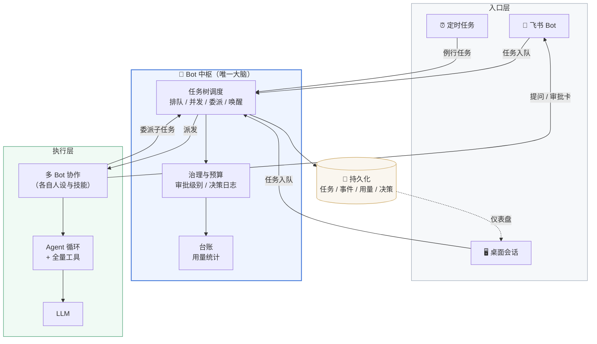

# 不需要 $30/月 Grok Bot，私有化部署一个 “Bot 🤖”！

作者：小傅哥
 博客：[https://bugstack.cn](https://bugstack.cn)

> 沉淀、分享、成长，让自己和他人都能有所收获！😄

大家好，我是技术UP主小傅哥。

`￥199.623` 人民币 `$30/月`，还只是初级 `Grok Bot` 套餐。就这，大部分伙伴想用，你还得找人帮你支付。那有没有低成本的，或者就不用花钱的，也不用折腾的，就能享受到 Bot 能力的智能体？🤔

    

**Bot ≈ 数字人，WaLiCode 的又一次 6.3万行代码的升级！**

- + 免费（不限量）LLM 模型（基本可以对标到 glm 5.3 flash），让大家用起来下手更无顾虑。
- + 内嵌浏览器（含 ego lite ），让 AI 像人一样操作浏览器（点击、滚动、分析，总结我的小红书推文质量）。甚至，AI 可以打开豆包作图，下载下来使用。
- + 连接器工具，DeepWiki、Github、Notion、飞书、钉钉、企业微信、QQ邮箱、企业网盘...，打通各类应用场景。
- + 语音识别模型，当你不想打字了，就可以直接语音方式完成信息的输入，非常方便处理。
- + UI 迭代（体验的优化），以及识别 `AGENTS.md` → `CLAUDE.md` → `.cursorrules` 回退链，注入 system prompt 半静态层（保持 KV Cache 前缀稳定）

综上，之后深度结合飞书，做了一款 WaLiBot 🤖；

    

**这不是把飞书与 WaLiCode 做简单的对接，而是实现了一个Bot 中枢；一句话，指挥一支 AI 团队。** 

WaLiCode 部署到你的电脑/服务器，WaLiBot 接上飞书，文字、语音、拉个群，就能开始对话。用法跟“用同事”一样爽（也可以把同事克隆进 Skills）：你把事情说清楚，它先干给你看，每一步在手机上实时滚动；碰到要花钱、要删东西、要往外发消息的动作，它会停下来发张审批卡，你点个“批准”它才继续——所以你敢把活交出去，也敢去开会、去吃饭，回来看结果就行。

它能接的活比想象中多。写代码是本行：把工程丢给它，改 Bug、写接口、重构、排查线上问题，改之前先出 Diff，你确认了才落盘；顺手还能登上你的服务器看日志、查进程。不止写代码——每天早上让它汇总一遍未读邮件和群消息、把今天的待办排个优先级；拉个群把产品和测试也进来，各自 @它 补充需求，它分得清谁在说什么，信息冲突了会停下来找人确认，而不是自作主张；让它盯着一个网页的更新、到点跑一遍数据报表、把结果整理好发回群里。重复的事只要交代一次，以后它到点自己干，结果自动推到飞书或你微信上。

时间长了，它记得你的偏好、你的项目背景、你说话的习惯，越用越顺手。权限分级、预算封顶，每花一个 token、每一次放行都有账可查，你在桌面端随时能看任务树和开销。它不是个更好的聊天框，是真能替你顶班的那个人——你负责说清楚要什么，剩下的交给它。

> 💐 接下来，小傅哥就带着你操作下，告诉你这东西怎么免费使用。此外，还会把 Bot 设计方案给你，让你把正在做的 Agent 智能体项目也能实现出 Bot 能力。—— Bot 不只是手机📱直接对接到智能体对话，而是有一个 AI 管理中枢，负责整个智能体会话的操作。

## 一、使用教程

### 1. 软件安装

- 官网：[https://walicode.xiaofuge.cn/](https://walicode.xiaofuge.cn/)
- 下载：[https://drive.weixin.qq.com/s?k=ACMA4AfQABUV1xP9Uo#/](https://drive.weixin.qq.com/s?k=ACMA4AfQABUV1xP9Uo#/)
- 仓库：[https://github.com/fuzhengwei/WaLiCode](https://github.com/fuzhengwei/WaLiCode)- `方便提交 issue，下载 Release 包。`

> ⚠️ 注意，下载 v0.8.0 版本。在设置里有移动端（Bot）能力。

### 2. 功能说明

    

- 首先，这是你安装 WaLiCode 与市面的 Codex、Workbuddy，都是类似的 AI Agent 工具产品，使用上基本大同小异。对话栏可以点击 `Free Model` 免费模型，进行对话操作。
- 之后，除了强大的编码能力，像是浏览器、PPT、Word、Excel等办公场景也都支持，对话框中的加号（+）可以选择这些（`@`也可以选择）。绿色的微信对话一样的图标，点击是创建新的对话。`有这些东西的介绍，你就可以先玩玩了。左侧的工程、代码、浏览器打开的文件、PPT等，都可以加入到对话框里使用。`

### 3. Bot 配置

#### 3.1 配置准别

    

个人版飞书没有开放平台 API 资质，机器人无法回信（错误 21001）。 必须使用**企业或组织租户**：已有公司 / 团队的飞书，切换过去即可； 没有就免费创建一个团队——飞书左上角**头像 → 登录更多账号 → 创建新账号**， 创建者角色选**「企业或组织负责人」**，个人即可创建、免费、无需营业执照。[https://www.feishu.cn/hc/zh-CN/articles/360043741453-%E5%88%9B%E5%BB%BA%E4%BC%81%E4%B8%9A](https://www.feishu.cn/hc/zh-CN/articles/360043741453-%E5%88%9B%E5%BB%BA%E4%BC%81%E4%B8%9A)

#### 3.2 接入飞书

    

- 一步操作，回到本页点**「接入飞书」**， 在上述团队租户内完成扫码授权，机器人 WaLiBot 会自动创建，无需进入飞书开发者后台。

#### 3.3 对话测试

    

- 首先，建议下一个手机版/电脑端，飞书。这样会更加好操作。直接看到发版的应用。
- 之后，打开应用（首次必做）：绑定完成后，在飞书顶部搜索 WaLiBot 并打开与它的聊天窗口。首次创建完必须先打开一次应用，机器人才能与你建立会话，之后随时对话即可。 配置完成后，点击这里唤起飞书客户端，搜索 WaLiBot 发起聊天即可开始使用。

#### 3.4 其他设置

管理后台；[https://open.feishu.cn/app](https://open.feishu.cn/app) - `进入你自己的飞书机器`

    

这个就是你在飞书创建的机器人对应的管理后台，在这里你可以完善菜单（比如一些快捷操作命令），之后发版新的机器人。

> 接下来，你就可以在手机端/电脑端，与你的远程 WaLiCode 进行对话了。这不是一个普通的接入 AI Agent，而是开发了一个 Bot 中枢，完成一系列用户指令，自动的创建对话。包括你的语音输入，图片输入，以及返回图片和文件等等。包括还可以读取你的邮件，给你做一些总结和回复。

## 二、讲解设计（Bot）

为了让伙伴理解 Bot 能力，这里我们拿 `WaLiCode` 的 Bot 与 `Grok Bot` 对比。其实整体体验来看，编码方面 WaLiCode 这种特定场景的产品，做工程开发会更好用。

### 1. 差异对比

| 能力维度     | Grok Bot                            | WaLiCode（v0.8.0）- WaLiBot                                  |
| :----------- | :---------------------------------- | :----------------------------------------------------------- |
| 多 bot 编制  | ✅ 多 bot 拉群互派活、Chief of Staff | ✅ botRoster + `delegate_task` + 任务树 waiting/resume + 四形态信封防注入 |
| 审批治理     | ✅ 审批卡，策略不透明                | ✅ 飞书审批卡闭环 + 级别继承 `max(own,inherited)` + 决策日志 + stalled 守卫 |
| 常驻生命周期 | ✅ 云端 7×24                         | ✅ 后台 agent 循环 + routine 进 hub 同路径治理（H5）+ 崩溃恢复事件溯源 |
| 结果触达     | 自家 App / X Chat                   | ✅ **飞书原生**：单聊/群聊@/引用回复路由/卡片审批/中文命令    |
| 执行场所     | ✅ xAI 云端电脑，**永不关机**        | ⚠️ 本机/云服务器（自己部署）；上云需按上轮分析抽无头 hub（周级工作，端口已预留） |
| 工具面       | 云端浏览器 + 连接器                 | ✅ 完整宿主权限（文件/shell/ssh/pty/git）+ MCP + Skills       |
| 模型/成本    | Grok 锁定，订阅 + 超 token 计费     | ✅ 任意 OpenAI/Anthropic 兼容端点（含本地模型），自付 API 账单但可精算（台账在手） |
| 生态/门槛    | ✅ 开箱即用，适合非技术用户          | 面向开发者和团队                                             |

### 2. 中枢设计

WaLiCode 的 Bot 中枢是一个以任务树为核心的调度治理大脑：飞书、桌面、定时任务三条入口的活都收敛成任务入队，由它统一排队、委派给多 Bot 协作执行，全程带上审批级别、预算与用量台账，人只在审批卡和提问时介入，结果可审计、成本可见。如图所示：

- **中枢位置在渲染层**：botHub 运行时是唯一大脑，持有任务树、准入、唤醒与决策；入口（飞书/桌面/调度器）只保留交互上下文，全部收敛为 hub 投影。
- **TurnRunner 端口解耦**：hub 通过 `canStart/validate/run/park/report` 端口调用宿主执行器，端口外的引擎、thread、卡片归宿主；端口 throw 视为暂不可用，永不把异常抛进 turn（I10）。
- **三条入口同一条治理路径**：飞书人工消息（person）、例程定时（routine，H5 经 `enqueueRoutineTurn` 入树 + 防重入）、bot 委派（bot，H2 `delegate_task`）走完全相同的准入/预算/统计。
- **先落库再行动**：`store.ts` 同步写状态文件 + 事件行，崩溃可由事件流重建（I7）；`usageLedger`/`decisionLog` 是 H4/H3 落地的仪表盘数据源。
- **审批闭环**：级别继承（`max(own, inherited)`）入队时冻结，执行器按级别自动批准或升级审批卡，卡/提问路由回 root 的飞书对话，人用 `/answer` 回答后经 `resume` 唤醒。

## 三、工程源码

小傅哥有一套 DSH Java 项目，通过 Java + DDD，1:1 复刻 Deepseek Harness 项目。26 个内置工具（7 文件操作、6 Shell/终端、3 Agent、4 Job、2 Web……）、27 个领域模块、外加 MCP 与插件两套动态工具扩展点。还做了 Web 端、桌面版、Plugin Skills 插件技能 + 100 个案例。

这回，小傅哥结合这样项目，加入了 Bot 能力。你可以直接拿到源码学习。分支 v0.1.9

    

> 这里有整套的源码的实现，可以下载后在本地，用 AI 工具，帮你启动（有一些前端的知识）。

### 1. 运行效果

    

- 首先，要在 DSH Java  Desktop 桌面端（启动后），在设置里飞书 Bot 开始绑定。会自动跳转浏览器，点击确认就可以。
- 之后，在你的飞书端，直接对话就可以了。与 WaLiBot 基本都是一样的东西。

### 2. 动态流程

如图，小傅哥设计了一个动态流程图，讲解 飞书 Bot 对接，我放到 dsh-java 项目里（`deepseek-harness/deepseek-harness-java/docs/bot/飞书Bot对接-交互式学习.html`）。

    

如图，把飞书 Bot 对接拆成四个故事——一键绑定、长连接建立、消息流式回复、管理操作——每个故事画成一张**可以点的时序图**，三栏联动：

- **左栏**：本次开发的全部类与方法，按 DDD 分层排列
- **中栏**：时序图，每条消息是一个可点击的步骤
- **右栏**：这一步"做了什么" + 最关键的“**💡 为什么这样设计**"

三种玩法：**▶ 播放**模式像动画一样自动走完全链路；点时序图任意一步，左侧对应代码**自动展开高亮**；读代码迷路时点左侧方法，直接跳回流程中的位置。适合三种人：零基础跟播放看热闹、进阶点步骤看门道、老手按图索骥查代码。
