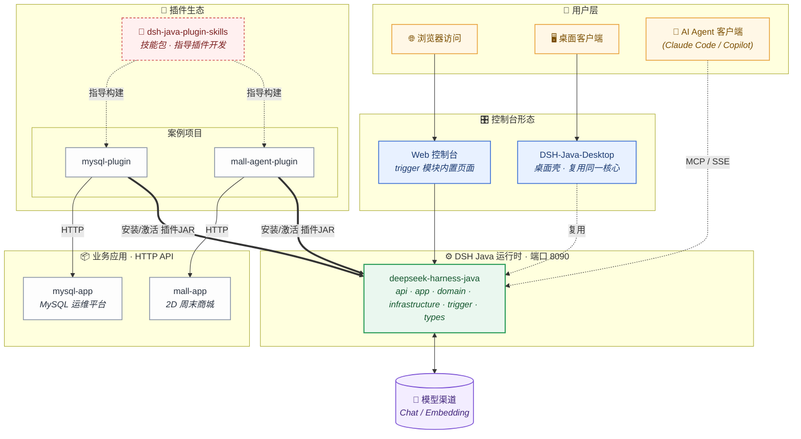
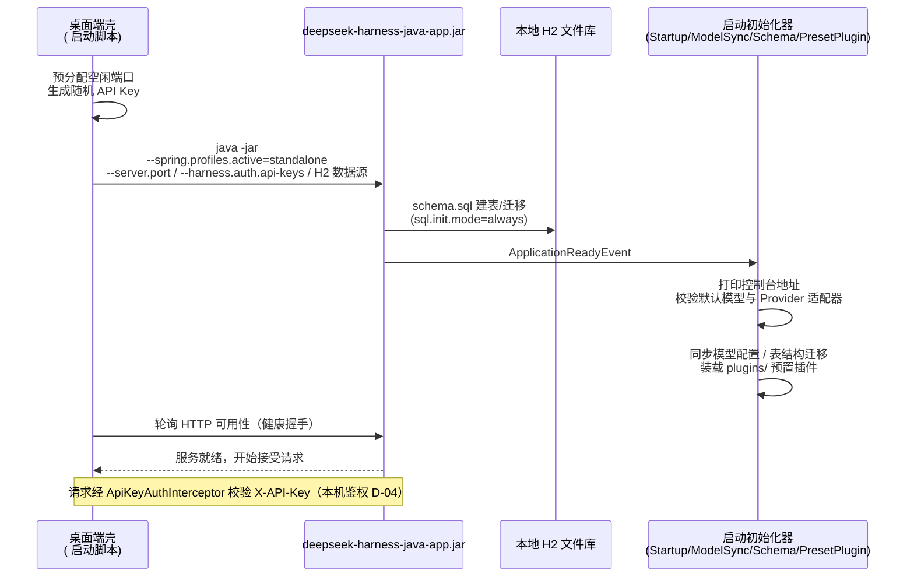
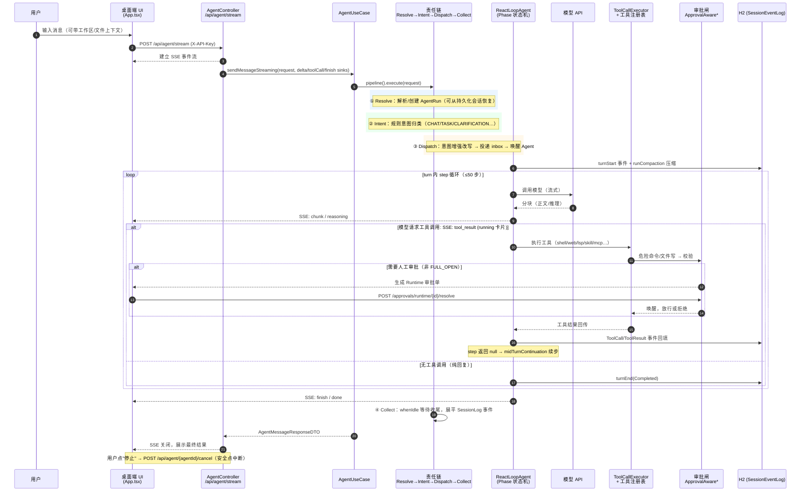

# DSH Java 从0到1，视频 + 文档，开始啦！—— web版、桌面端、插件 skills + 100 种场景案例，足够硬核啦！

作者：小傅哥
 博客：[https://bugstack.cn](https://bugstack.cn)
 项目：[https://t.zsxq.com/kYcVt](https://t.zsxq.com/kYcVt)

>沉淀、分享、成长，让自己和他人都能有所收获！😄

大家好，我是技术UP主小傅哥。

**这事可是不小** 😱；先是用 Java + DDD 架构，`1:1 复刻 Deepseek Harness 项目`，干了1个来月（`这里有大量的架构分析和领域结构设计`），并以 ClassLoader 热插拔的方式设计 SPI 的 Plugin 插件机制。以及提供了 plugin skills 技能，可以快速开发各类场景的智能体应用。🚄 快速🔜，有多快呢！一周干了100+个场景案例。

> 地址：[https://github.com/deepseek-harness-java](https://github.com/deepseek-harness-java) - `就是说你脑子没啥想法，那这100多个案例，你可劲玩吧！`

    

DSH Java 可不是`呆毛（Demo）`项目，它是一套正儿八经的企业级解决方案（**已有企业里的伙伴，拿过去开始使用**）。为了能让这套东西更加成熟稳定，小傅哥连着迭代了8个版本（并且持续跟进 DeepSeek Harness 马具工程 🐴）。为 DSH Java 运行时 Agent 更加全面的达到企业级诉求，也对应实现了 Web 版本，桌面版本 + 数字人（A2A）。并且于 2026年10月14日，AppImage 收入了 DSH Java Desktop 桌面版。[https://github.com/AppImage/appimage.github.io/pull/9999](https://github.com/AppImage/appimage.github.io/pull/9999) - `这个成绩还不错！`

    

那么，现在 DSH Java 这套项目的核心能力都已经做完了。所以，小傅哥开始提供手把手学习的课程，帮助小白伙伴从0到1的完成智能体开发的学习。接下来，小傅哥就带着大家看下在这套 DSH Java 项目下；Web/桌面端都是什么效果、Plugin Skills 怎么用，100个场景都是啥，课程有什么章节要怎么讲等等。好的，那开始发车！🚗

> 💐文末提供了小傅哥全套的 AI Agent 项目的实战学习路线，从0到1，从基础设施到应用，由浅入深，多套架构方案设计实现。可以让你学的盆满钵满！

## 一、项目介绍

**官网**：[https://dsh-java.xiaofuge.cn/](https://dsh-java.xiaofuge.cn/)

DSH Java 是一个以「稳定内核 + 统一插槽 + 插件化扩展」为核心的 AI Agent 运行时框架（Java 版），采用 Spring Boot DDD 多模块结构 / case / domain / infrastructure / trigger / types）。核心能力包括：ReAct 推理循环、统一工具注册（ToolRegistry，fs / shell / web / mcp / lsp / terminal 等）、Hook 拦截链、Java 插件热插拔（ClassLoader + SPI）、进程外扩展（MCP / sidecar / 子代理）等，配套 `web 版本`、`桌面版（DSH-Java-Desktop）`、`插件开发技能`以及插件脚手架 archetype，共 100 个实战插件开发案例。

之后我们来演示下，项目是如何启动的。分为 Web 版本和 桌面版版本。`如果你暂时只是想体验，还不需要源码构建。可以直接用官网下载桌面版或者部署web体验。`

### 1. 体验 `web`

#### 1.1 IntelliJ IDEA 启动

	

- 注意，本地启动 `application.yml` 走的是 mysql 数据库。工程里提供的 `deepseek_harness_java.sql` 要提前执行好，之后在 `application.yml` 文件中进行配置。

#### 1.2 访问 web

	

- 默认地址：[http://localhost:8090/](http://localhost:8090/)
- 使用说明：启动后可以在设置里，添加上你的模型。之后就可以对话使用了。

### 2. 启动 `桌面端`

	

桌面版（DSH-Java-Desktop）基于 Tauri 构建，其核心思路是：**把后端 Agent 的 SpringBoot 可执行 Jar 作为资源文件"复制"进客户端安装包**，并内置一份精简 JRE，用户安装后无需配置 Java 环境即可直接运行。整个"打包 Jar → 桌面端启动"的完成过程如下。

> 下面是前端的打包构建阶段，没咋操作过前端的伙伴，可以用 AI 工具完成先分析2个项目，之后让构建服务端的jar，放到客户端启动桌面版。

#### 2.1 对话效果

	

整套 ui 界面，类似 XxxBuddy 类产品，和星球「`码农会锁`」另外一套 WaLiCode 主要面向编码的，在 UI 设计上是有所不同的。可以整体感受下，这两个 UI 也是 `25年 ~ 26年` 逐步成型的两个分类。

#### 2.2 设置界面

	

设置界面有完整的模型配置，简单数字人（A2A）、Skills、MCP、CLI，以及插件的安装。整套东西还是蛮好玩的，这个桌面端，「星球里的伙伴」你可以拿去进行二开，做自己的 AI 产品。

## 二、技能使用

DSH Java 最核心的一个价值，其实是 DSH Plugin 能力。它的目的就是让你的N多个业务系统，有任何智能体场景诉求的时候，都可以非常方便的接入 AI Agent 智能体。比如；`电商 + 导购客服`、`旅游 + 路线规划`、`信贷 + 资质预审`、`MySQL + 智能运维`、`Git + 代码审查` ... 等等，在能提高用户体验，节省等待时耗的场景，都可以引入智能体，增强整个产品的功能能力。

安装技能（把这段内容发给 AI Agent 工具）；[`请帮我安装 dsh-java-plugin-skills 技能，地址：https://github.com/deepseek-harness-java/dsh-java-plugin-skills 并告诉我它的实际用途以及如何使用`](https://github.com/deepseek-harness-java/dsh-java-plugin-skills)

	

> 以下产品，你可以通过仓库地址进入，需要哪个案例，就验证测试哪个。地址；[https://github.com/deepseek-harness-java](https://github.com/deepseek-harness-java)

#### 1. 🧩 27 个独立 AI 产品

工具优先——每个产品解决一类真实工作流（开发/数据/运维/写作），AI 能组合多工具完成"一句话任务"；数据本地优先（`~/.dsh-java-<name>/`），无外部 SaaS 依赖。

###### 🔧 开发者工具

| 仓库 | 产品 · 能力 |
|---|---|
| [dsh-java-git](https://github.com/deepseek-harness-java/dsh-java-git) | Git Story Studio · git 历史分析/变更摘要/回滚建议（不改写历史） |
| [dsh-java-log](https://github.com/deepseek-harness-java/dsh-java-log) | Log Lens · 日志筛选/模式聚类/异常定位 |
| [dsh-java-api](https://github.com/deepseek-harness-java/dsh-java-api) | API Sketch · API 接口草图/OpenAPI 生成/字段校验 |
| [dsh-java-cron](https://github.com/deepseek-harness-java/dsh-java-cron) | Cron Forge · cron 表达式解析/触发时间/校验 |
| [dsh-java-env](https://github.com/deepseek-harness-java/dsh-java-env) | Env Doctor · 环境一致性体检/密钥脱敏扫描 |
| [dsh-java-dep](https://github.com/deepseek-harness-java/dsh-java-dep) | Dependency Radar · 依赖雷达/版本冲突/CVE 提示 |
| [dsh-java-diff](https://github.com/deepseek-harness-java/dsh-java-diff) | Diff Narrator · 代码变更叙事/风险扫描/回滚计划 |
| [dsh-java-regex](https://github.com/deepseek-harness-java/dsh-java-regex) | Regex Forge · 正则解释/测试/生成/优化 |
| [dsh-java-shell](https://github.com/deepseek-harness-java/dsh-java-shell) | Shell Buddy · 命令解释/风险提示/安全替代建议 |
| [dsh-java-json](https://github.com/deepseek-harness-java/dsh-java-json) | JSON Lens · JSON 解析/校验/对比/路径查询 |

###### 📊 数据与效率

| 仓库 | 产品 · 能力 |
|---|---|
| [dsh-java-csv](https://github.com/deepseek-harness-java/dsh-java-csv) | CSV Studio · CSV 清洗/转换/校验/统计 |
| [dsh-java-markdown](https://github.com/deepseek-harness-java/dsh-java-markdown) | Markdown Doctor · 文档体检/结构修复/链接检查 |
| [dsh-java-meeting](https://github.com/deepseek-harness-java/dsh-java-meeting) | Meeting Digest · 会议纪要/行动项提取/跟进 |
| [dsh-java-inbox](https://github.com/deepseek-harness-java/dsh-java-inbox) | Inbox Triage · 邮件分诊/优先级/归档建议（不代发邮件） |
| [dsh-java-backlog](https://github.com/deepseek-harness-java/dsh-java-backlog) | Backlog Shaper · 需求整理/用户故事/优先级矩阵（不代替拍板） |
| [dsh-java-glossary](https://github.com/deepseek-harness-java/dsh-java-glossary) | Term Atlas · 团队中英术语典/文档挖词/双语卡片（不改他人释义） |
| [dsh-java-recall-deck](https://github.com/deepseek-harness-java/dsh-java-recall-deck) | Recall Deck · 记忆卡工坊/SM-2 间隔重复/学习统计（不删学习进度） |
| [dsh-java-style](https://github.com/deepseek-harness-java/dsh-java-style) | Tone Tuner · 文风画像/改写建议/可读性/术语校对（不动原稿） |
| [dsh-java-faq](https://github.com/deepseek-harness-java/dsh-java-faq) | FAQ Builder · 客服记录聚类/FAQ 草稿/覆盖缺口（不臆造政策答复） |
| [dsh-java-storymap](https://github.com/deepseek-harness-java/dsh-java-storymap) | Story Mapper · 用户旅程画板/痛点扫描/情绪曲线（不替代用户研究） |
| [dsh-java-release](https://github.com/deepseek-harness-java/dsh-java-release) | Release Notes Hub · 发布中枢/渠道文案变体/时间线（不直接对外发布） |

###### 🛡️ 安全与运维

| 仓库 | 产品 · 能力 |
|---|---|
| [dsh-java-secret](https://github.com/deepseek-harness-java/dsh-java-secret) | Secret Sweeper · 密钥泄漏扫描/熵检查/轮换清单（明文脱敏） |
| [dsh-java-docker](https://github.com/deepseek-harness-java/dsh-java-docker) | Docker Lens · 镜像容器清单/瘦身/dockerfile lint（不 stop/rm 容器） |
| [dsh-java-nginx](https://github.com/deepseek-harness-java/dsh-java-nginx) | Nginx Composer · 配置解析/路由表/错误 lint（不写回不 reload） |
| [dsh-java-ssh-fleet](https://github.com/deepseek-harness-java/dsh-java-ssh-fleet) | SSH Fleet Notes · 服务器舰队手册/巡检清单（不发起真实连接） |
| [dsh-java-firewall-plan](https://github.com/deepseek-harness-java/dsh-java-firewall-plan) | Port Guard · 端口快照/冲突诊断/防火墙建议（不 kill 进程） |
| [dsh-java-backup-audit](https://github.com/deepseek-harness-java/dsh-java-backup-audit) | Backup Auditor · 备份健康检查/3-2-1 策略评估（不删不改备份） |

#### 2. 🏭 74 个行业场景案例

每个案例 = 「业务应用 + 内嵌 AI 助手 + Java Native 插件」的完整可运行仓库，覆盖零售、出行、生活服务、教育、工作协作等行业。

###### 🛒 商城零售与生活电商

| 仓库 | 场景 |
|---|---|
| [digital-mall](https://github.com/deepseek-harness-java/digital-mall) | P1 虚拟数码商城 · AI 购物助手 |
| [fresh-group-buy](https://github.com/deepseek-harness-java/fresh-group-buy) | P2 生鲜社区团购 · AI 买菜助手 |
| [takeout-platform](https://github.com/deepseek-harness-java/takeout-platform) | P6 外卖订餐平台 · AI 美食助手 |
| [shop-review](https://github.com/deepseek-harness-java/shop-review) | P7 周边探店点评 · AI 探店助手 |
| [marketing-factory](https://github.com/deepseek-harness-java/marketing-factory) | P9 营销活动工厂 · AI 营销助手 |
| [points-mall](https://github.com/deepseek-harness-java/points-mall) | 会员积分商城 · AI 积分助手 |
| [coffee-ordering](https://github.com/deepseek-harness-java/coffee-ordering) | 咖啡下单管家 · AI 点单助手 |
| [tea-shop](https://github.com/deepseek-harness-java/tea-shop) | 茶饮点单管家 · AI 茶饮助手 |
| [veggie-box](https://github.com/deepseek-harness-java/veggie-box) | P81 净菜周配管家台 |
| [breakfast-club](https://github.com/deepseek-harness-java/breakfast-club) | P97 早餐鲜配 · AI 管家 |

###### 💰 金融与个人事务

| 仓库 | 场景 |
|---|---|
| [personal-ledger](https://github.com/deepseek-harness-java/personal-ledger) | P3 个人记账助手 · 流水/预算/月报 |
| [credit-simulator](https://github.com/deepseek-harness-java/credit-simulator) | P4 小额信贷模拟器 · 试算 + AI 推荐 |
| [insurance-claims](https://github.com/deepseek-harness-java/insurance-claims) | P58 保险理赔助手台 · 核验/测算/审核 |
| [expense-reimburse](https://github.com/deepseek-harness-java/expense-reimburse) | P57 费控报销助手台 · 合规校验/审批 |

###### 🚕 出行 · 物流 · 酒旅 · 文旅

| 仓库 | 场景 |
|---|---|
| [trip-planner](https://github.com/deepseek-harness-java/trip-planner) | P5 城市出行规划 · 三网聚合三方案 |
| [express-tracking](https://github.com/deepseek-harness-java/express-tracking) | 快递查寄台 · 轨迹/运费/下单/异常预警 |
| [hotel-booking](https://github.com/deepseek-harness-java/hotel-booking) | 酒店预订管家 · 房态日历/二次确认下单 |
| [scenic-guide](https://github.com/deepseek-harness-java/scenic-guide) | 景区智慧导览 · 客流避堵/路线规划 |
| [zoo-tour](https://github.com/deepseek-harness-java/zoo-tour) | P85 动物园导览管家台 |
| [yacht-rental](https://github.com/deepseek-harness-java/yacht-rental) | P84 游艇租赁管家台 |
| [car-rental](https://github.com/deepseek-harness-java/car-rental) | 租车管家 · 车辆/门店/订单/维保 |

###### 🏠 生活服务与门店经营

| 仓库 | 场景 |
|---|---|
| [online-clinic](https://github.com/deepseek-harness-java/online-clinic) | P11 在线问诊导诊 · AI 仅导诊不诊断 |
| [dental-clinic](https://github.com/deepseek-harness-java/dental-clinic) | 牙科诊所助手台 · 排班/挂号/病历 |
| [doctor-outpatient](https://github.com/deepseek-harness-java/doctor-outpatient) | P40 医生门诊工作站 · 病历摘要 |
| [pet-clinic](https://github.com/deepseek-harness-java/pet-clinic) | 宠物医院助手 · 兽医排班/档案 |
| [vet-clinic-af](https://github.com/deepseek-harness-java/vet-clinic-af) | 安心宠物疫苗驱虫门诊 |
| [pet-board](https://github.com/deepseek-harness-java/pet-board) | 宠物寄养连锁管家 |
| [pet-boarding](https://github.com/deepseek-harness-java/pet-boarding) | P87 宠物寄养管家台 |
| [pet-grooming](https://github.com/deepseek-harness-java/pet-grooming) | P100 毛孩子美容会所 |
| [gym-membership](https://github.com/deepseek-harness-java/gym-membership) | P68 健身房会籍管家 |
| [gym-coach](https://github.com/deepseek-harness-java/gym-coach) | P86 健身私教管家台 |
| [swimming-pool](https://github.com/deepseek-harness-java/swimming-pool) | P78 游泳培训管家 |
| [housekeeping-cleaning](https://github.com/deepseek-harness-java/housekeeping-cleaning) | P69 家政保洁管家 |
| [errand-service](https://github.com/deepseek-harness-java/errand-service) | P77 跑腿代办管家 |
| [moving-service](https://github.com/deepseek-harness-java/moving-service) | 搬家服务连锁管家 |
| [laundry-service](https://github.com/deepseek-harness-java/laundry-service) | 连锁洗衣管家 |
| [laundry-room](https://github.com/deepseek-harness-java/laundry-room) | P88 洗衣管家台 |
| [hair-salon](https://github.com/deepseek-harness-java/hair-salon) | 连锁美发沙龙管家 |
| [appliance-repair](https://github.com/deepseek-harness-java/appliance-repair) | 家电维修连锁管家 |
| [photography-studio](https://github.com/deepseek-harness-java/photography-studio) | P75 摄影预约管家 |
| [kids-photo](https://github.com/deepseek-harness-java/kids-photo) | P89 亲子摄影管家台 |
| [flower-subscription](https://github.com/deepseek-harness-java/flower-subscription) | 鲜花订阅管家 |
| [car-care](https://github.com/deepseek-harness-java/car-care) | 汽车养护门店助手 · AI 不做故障诊断 |
| [restaurant-ops](https://github.com/deepseek-harness-java/restaurant-ops) | 餐饮门店经营台 · AI 店长台 |
| [property-service](https://github.com/deepseek-harness-java/property-service) | P60 智慧物业管家台 |
| [library-seat](https://github.com/deepseek-harness-java/library-seat) | P61 图书馆自习室管家台 |
| [study-room](https://github.com/deepseek-harness-java/study-room) | 静光社区自习室 |
| [tool-shed](https://github.com/deepseek-harness-java/tool-shed) | 万能社区工具棚 · 共享租借 |
| [community-kitchen](https://github.com/deepseek-harness-java/community-kitchen) | 邻里香社区共享厨房 |
| [eldercare-center](https://github.com/deepseek-harness-java/eldercare-center) | 夕阳暖老年日间照料中心 |
| [smart-farm](https://github.com/deepseek-harness-java/smart-farm) | 云上田园智慧农场 |
| [kids-club](https://github.com/deepseek-harness-java/kids-club) | P96 童萌团儿童托管班 |
| [wedding-planner](https://github.com/deepseek-harness-java/wedding-planner) | P98 花好月圆婚礼策划 |
| [badminton-hall](https://github.com/deepseek-harness-java/badminton-hall) | P99 飞扬羽毛球馆 |
| [tutoring-book](https://github.com/deepseek-harness-java/tutoring-book) | 家教预约管家 |
| [xylophone-class](https://github.com/deepseek-harness-java/xylophone-class) | P83 马林巴课程顾问台 |
| [water-purifier](https://github.com/deepseek-harness-java/water-purifier) | P82 净水器租赁管家台 |
| [umbrella-share](https://github.com/deepseek-harness-java/umbrella-share) | P80 共享雨伞管家台 |
| [smart-mes](https://github.com/deepseek-harness-java/smart-mes) | P59 智能制造 MES 生产助手台 |

###### 💼 工作协作与内容

| 仓库 | 场景 |
|---|---|
| [team-kanban](https://github.com/deepseek-harness-java/team-kanban) | P8 团队项目看板 · AI 看板助手 |
| [community-plaza](https://github.com/deepseek-harness-java/community-plaza) | P10 兴趣社区广场 · AI 社区助手 |
| [livestream-review](https://github.com/deepseek-harness-java/livestream-review) | 直播带货复盘台 · AI 复盘助手 |

###### 🖥️ 产研测运维工作台

| 仓库 | 场景 |
|---|---|
| [deploy-monitor](https://github.com/deepseek-harness-java/deploy-monitor) | P30 发布上线监控台 · GO-NO-GO/一键回滚 |
| [dev-collab](https://github.com/deepseek-harness-java/dev-collab) | P31 研发协作工具台 · MR 评审/技术债 |
| [test-workbench](https://github.com/deepseek-harness-java/test-workbench) | P32 测试用例工作台 · 追溯矩阵/漏测分析 |
| [pm-workbench](https://github.com/deepseek-harness-java/pm-workbench) | P33 产品需求工作台 · 优先级/PRD/排期 |
| [duty-desk](https://github.com/deepseek-harness-java/duty-desk) | P34 生产值班巡检台 · 值班/告警/交接班 |

###### 🎓 教育学习

| 仓库 | 场景 |
|---|---|
| [teacher-workbench](https://github.com/deepseek-harness-java/teacher-workbench) | P35 教师教学工作台 · 学情/教案/批改 |
| [math-think](https://github.com/deepseek-harness-java/math-think) | P36 数学思维训练 · 错因/变式题组 |
| [chinese-writing](https://github.com/deepseek-harness-java/chinese-writing) | P37 语文阅读写作 · 书单/作文批改 |
| [english-listening](https://github.com/deepseek-harness-java/english-listening) | P38 英语听说训练 · 跟读评分 |

###### 👥 角色工作台

| 仓库 | 场景 |
|---|---|
| [sales-crm](https://github.com/deepseek-harness-java/sales-crm) | P39 销售 CRM · 客户 360/商机漏斗 |
| [lawyer-case](https://github.com/deepseek-harness-java/lawyer-case) | P41 律师办案助手 · 不构成法律意见 |
| [hr-recruit](https://github.com/deepseek-harness-java/hr-recruit) | HR 招聘助手 · AI 不做录用决定 |

基于这套 skills 技能，在玩1-2个场景后，你也可以熟练的把你需要的场景快速对接上 Agent，也可以开发一个新的场景。

## 三、架构设计

### 1. 整体结构

**总体定位**：DSH Java 是一个以「稳定内核 + 统一插槽 + 插件化扩展」为核心的 AI Agent 运行时框架，采用 Spring Boot DDD 多模块单体结构，既可以独立部署为 Web 服务（MySQL），也可以以打包好的 jar 形态被桌面端内嵌拉起（standalone 模式 + H2 文件库），"一套代码、两种交付形态"。

	

#### 1.1 DDD 模块划分

工程按照 DDD 四层架构拆分，各模块职责边界清晰、依赖方向自外向内：

| 模块 | 职责 |
|---|---|
| `app` | 启动与装配：`Application.main()` 入口、启动初始化器（Startup/ModelSync/Schema/PresetPlugin） |
| `trigger` | HTTP/SSE 入口：`AgentController`（stream/message/status/cancel）、控制台、审批等控制器 |
| `case` | 用例编排：`AgentUseCase` + 责任链（Resolve → Collect），只做"解析→意图→投递→收集"的编排外壳 |
| `domain` | Agent 核心域：`ReactLoopAgent` 推理循环、工具体系、审批闸、会话事件溯源 |
| `infrastructure` | 持久化与网关：Repository/DAO/PO，MySQL（web）或 H2（standalone） |
| `api` / `types` | 对外契约：DTO 与接口定义 |

#### 1.2 内核与插槽

整套架构的主线是**「一切能力皆工具，一切扩展皆插槽」**：

- **稳定内核**：契约层、LLM 适配、ReAct 推理循环（`ReactLoopAgent`，Phase 状态机 + inbox 消息驱动 + SessionEventLog 事件溯源）、内置工具，是框架的心脏，不随场景变化。
- **统一插槽**：
  - **ToolRegistry**：fs / shell / web / mcp / lsp / terminal / skill 等工具的统一注册与选择（`CompositeToolRegistry` / `AgentToolCatalog`），内核能力与插件能力在这里汇流。
  - **Hook 链**：拦截工具调用前后，插件可注入切面逻辑（审计、脱敏、风控）。
  - **端口适配**：仓储、事件等以端口方式暴露，infrastructure 可替换实现。
- **插件化扩展**：Java 插件经 ClassLoader + SPI 热插拔加载，与内核同 JVM——工具直接调用零序列化开销，能注册 Hook 拦截工具调用、走事件总线与内核深度协作（区别于进程外 MCP 与纯提示词 Skills）。插件契约即 `AbstractHarnessPlugin` / `PluginContext` / `PluginHook`，启动时由 `PresetPluginLoader` 装载 `plugins/` 目录预置插件。

### 2. 流程设计

#### 2.1 启动流程

**桌面端（standalone 模式）**：Tauri 壳负责进程托管，以如下命令拉起 jar 子进程：

**流程说明：**

1. **进程托管**：桌面端壳层分配、随机 Key 生成与子进程生命周期管理，后端进程随桌面端退出而关闭，不留孤儿进程。
2. **参数即架构声明**：一条启动命令把"远程服务端"切换为"本地自治进程"——H2 文件库替换 MySQL、动态端口避开冲突、随机 Key 保证本机安全，服务端代码零改动。
3. **健康握手**：壳层轮询 HTTP 可用性，服务就绪后才加载前端主界面，保证用户看到界面时服务一定可用。
4. **插件随启动装载**：`PresetPluginLoader` 在启动链末段装载 `plugins/` 预置插件，扩展能力在服务挂载完成。

#### 2.2 对话流程

**入口与调用链**：HTTP 入口位于 trigger 层 `AgentController`（`/api/agent`）：

**流程说明：**

1. **双层结构**：case 层责任链只做"解析→意图→投递→收集"的编排外壳，ReAct 循环下沉到 domain 层 `ReactLoopAgent`（Phase 状态机 + inbox 消息驱动 + SessionEventLog 事件溯源），编排与推理解耦。
2. **三重防护**：单 turn 最多 50 step、token 续接最多 4 次、取消信号即时中止，保证循环不会失控。
3. **人机协同**：危险操作以"审批挂起/唤醒"机制实现——Agent 挂起等待用户决议，而不是静默执行或直接拒绝。
4. **可恢复性**：全量事件溯源落库，进程重启或会话中断后可从断点恢复上下文，而不是从头再来。

## 四、课程计划

按照 v0.1.8 版本分支，小傅哥做了一份课程计划。接下来，我们会按照这个节奏推进。

	

整体节奏是"先把内核立起来，再把插槽做成产品"，共 12 个 Part、五个阶段，从 v0.1.8 冻结基线的 7 模块骨架出发，最终交付一个与基线全量一致、零依赖可启动、可打包分发的完整 Agent 运行时。

- **阶段一 · 基础处理**：契约先行，模型可换。Part 01 建立契约层（types + api），定义 Message / ToolCallBlock 消息与工具模型、插件 SPI 契约，沉淀 api 23 接口 + 55 DTO——这是 Agent 世界的通用语言；Part 02 做 LLM 适配（DeepSeek 适配器、OpenAI 兼容 / Anthropic 路由工厂）并顺手长出最小 HTTP/SSE 壳，支持阻塞式 message、SSE stream 与模型设置热切换。此阶段达成 **M1 能答**：curl 问答、流式逐字，此后每节验证都走真实协议入口。

- **阶段二 · 智能结构**：Part 03 是全课程核心——ReAct 循环（ReactLoopAgent、工具调用解析与结果回填、循环控制（步数/取消/超时）、SSE 事件协议、系统提示词装配、CompactionEngine 会话压缩）；Part 04 装上"手"——工具系统（ToolRegistry、ToolCallExecutor、fs 工具族、shell + 危险命令守卫、web 搜索抓取、ask_user_question 运行时提问、PRE/POST Hook 链）。从一问一答升级为自主多步循环，且**可控（循环控制）、可见（事件流）、不失控（压缩）**，达成 **M2 会思考**（自主多步推理）与 **M3 会干活**（查资料→写文件一条龙）。

- **阶段三 · 记忆约束**：Part 05 持久化与事件溯源——MyBatis 地基、SessionEventFactory、双事件存储（JSONL 文件 + JDBC）、Rebuilder/Projector 会话重建，达成 **M4 有记忆**（重启不丢会话、事件可回放）；Part 06 任务与审批主线——任务队列落库、权限矩阵评估、审批命令/查询、运行时审批网关（Shell 挂起）、Goal/Plan 与 Todo/Jobs，达成 **M5 受治理**（高危操作挂起等审批）。内存版进化为落库版是反复出现的演进叙事；能力越强缰绳越紧，危险必审批。

- **阶段四 · 成品迭代**：先直连后抽象的演进叙事，把最小壳长成产品形态。Part 07 用例编排层（CasePipeline 策略树、终端五节点、任务链重构、Agent 消息编排四节点）；Part 08 触发层与控制台（Controller 分层、统一响应、SSE 批处理、API Key 鉴权），达成 **M6 工程化**（浏览器控制台）；Part 09 Java 插件体系（加载器、SpringPluginContext、生命周期、事件总线、Hook、配置热更新、archetype 脚手架）；Part 10 进程外扩展（MCP stdio/http、Node sidecar JSON-RPC 桥、子代理 Provider——Claude Code/Codex/ACP）。**装插件即长能力**，能力挂载从进程内延伸到进程外。

- **阶段五 · 收尾阶段**：扩展篇，做一些收尾的处理。Part 11 平台能力进阶（选修，5 节）：沙箱与执行边界、凭证管理与技能加载、计划任务与终端、工作流引擎、数字人与 A2A 协议（AgentCard 可发现）；Part 12 完结：standalone 零依赖、Docker Compose、差量合入与全量对账（终态 = v0.1.8 冻结基线），达成 **M8 可交付**：package-local.sh 产物新机器跑通。

四条横向主线贯穿全课程：**① 契约**（消息模型→对外接口→SSE 事件协议→子代理契约）、**② 安全**（危险命令守卫→权限矩阵→审批网关→沙箱边界→API Key）、**③ 数据**（设置内存版→建表→双事件存储→落库恢复→任务/插件落库）、**④ 验证**（最小 HTTP/SSE 壳→分层统一响应→Web 控制台→打包分发）。

---

综上，内容还是比较大的，毕竟这是一套完整的企业级解决方案。不过，也不用担心学不会，因为全程小傅哥都会带着你走。还为你提供了配套的基础教程，可以在上手之前进行补充学习。

**ToyAgent** —— 这一套快速上手的入门教程，我把基于 DSH Java 拆分了最初的上车课程。一个类就是一个最小 MVP 版本的智能体，每个章节只有一个知识点，非常容易学习。如下；

      
	 

      
	 

> 好啦，要投递 AI Agent 岗位，以及需要转行到智能体开发的伙伴，千万不要错过！💐
