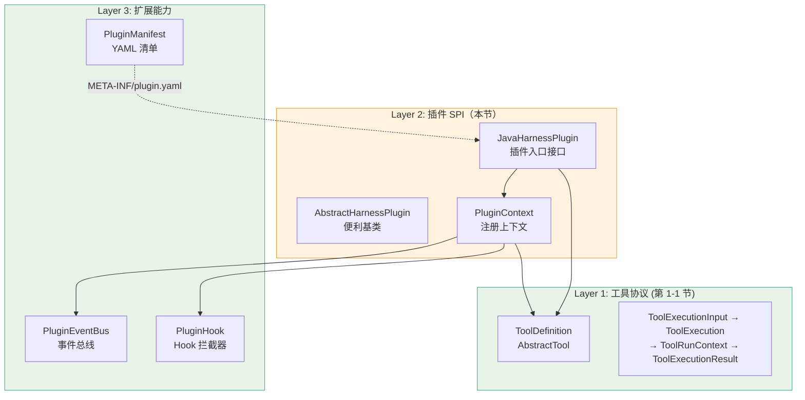

# 《DeepSeek Harness Java》第1-2节：契约定义(types)，插件SPI机制

作者：小傅哥
 博客：[https://bugstack.cn](https://bugstack.cn)
 视频：[https://t.zsxq.com/qLDd9](https://t.zsxq.com/qLDd9)

>沉淀、分享、成长，让自己和他人都能有所收获！😄

大家好，我是技术UP主小傅哥。

要想让我们实现的 Java 版本 Harness 工程具备插件化功能逻辑，那么在一开始我们就需要通过 Java 语言特性定义出来对应的 SPI（Service Provider Interface）机制。可以满足接入方用统一标准的方式进行实现，再构建 Jar 进行注册到 Harness 工程进行使用。

>插件模式的核心价值：解耦。Harness 内核不硬编码任何业务逻辑，所有业务场景都通过插件动态加载。你可以对运维、电商、营销、交易，以实现插件的方式进行对接使用。并按需把这些服务分组部署。后续升级业务插件，以及 Harness 版本，有也都是分开的。像是星球「码农会锁」提供的 SpringBoot Starter 工程、扳手工程（设计模式框架、动态配置中心...）、本地消息组件（一直性解决方案）都是这类思想。

## 一、本章诉求

插件 SPI 的设计目标是**让第三方开发者零依赖 Spring、零框架耦合的开发插件**。开发者只需要引入 `deepseek-harness-java-types` 模块（scope=provided），实现 `JavaHarnessPlugin` 接口或继承 `AbstractHarnessPlugin`，打包成 JAR 后放入 Harness 的 `plugins/` 目录即可。

>DeepSeek Harness (DSH) Java 生态 [https://github.com/deepseek-harness-java](https://github.com/deepseek-harness-java) 提供了插件技能和对应的100+个场景案例。你可以在 AI 工具（walicode、codex、workbuddy），安装技能后体验。

那么，结合着咱们前两节的内容，用一个图来体现下 LLM 工具调用协议与插件 SPI 的整个工作流程。这样我们会更好理解这一节要干啥。

- 左上，**Layer 3（扩展能力）**：事件总线和 Hook 提供插件间通信和拦截能力。将来开发好的插件，就有这么一个清单标准。
- 中间，**Layer 2（插件 SPI）**：定义如何将多个工具打包成一个插件并注册。所有的插件，都是以这样一个类的定义继承实现的。
- 右下，**Layer 1（工具协议）**：定义单个工具的接口和执行链。本章节小傅哥也会提供测试案例，简单串联整个流程。

综上，插件机制帮我们带来了什么；

1. PluginContext， 如果插件直接持有宿主引用（如 `AgentLoop`），就会造成紧耦合。`PluginContext` 作为**最小权限注册边界**，只暴露必要的注册方法，插件无法访问宿主内部状态，符合安全原则。
2. PluginEventBug，插件之间不应直接调用对方 API（会造成循环依赖）。通过事件总线，插件 A 可以发布"会话开始"事件，插件 B 订阅该事件并记录日志，两者完全解耦。
3. Hook，安全审计、权限控制、请求脱敏等功能需要插入到工具执行的特定节点。Hook 提供了一种标准化的插拔机制，无需修改核心代码。
