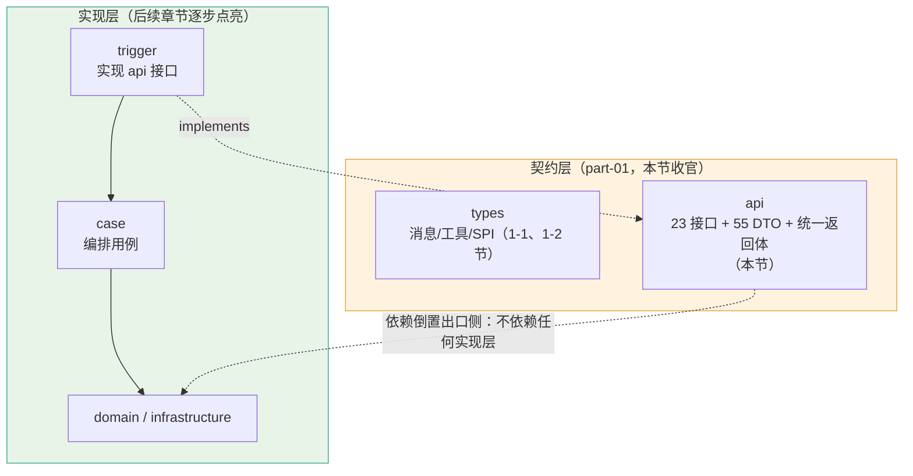

# 《DeepSeek Harness Java》第1-3节：契约定义-api，接口层定义

作者：小傅哥
 博客：[https://bugstack.cn](https://bugstack.cn)
 视频：[https://t.zsxq.com/qLDd9](https://t.zsxq.com/qLDd9)

>沉淀、分享、成长，让自己和他人都能有所收获！😄

大家好，我是技术UP主小傅哥。

在互联网公司日常的需求研发设计评审完，总会先听到一句话：”你把接口先给我“。功能还没写呢，但你需要先把接口定义出来，给到其他伙伴（前端、或者其他应用对接的后端，从这你这获取`交易`、`营销`、`账务`、`商品`等信息）。

那这一节我们就来定义接口标准，也是整个`契约定义`的最后一个 api 层的设计，包括；接口类、dto 对象、流式传输。在系统定义完 api 后，是可以把这一层 Module 打包成 Jar 发布出去，让其他调用方引入。当然前端是不需要引入 Jar 的，主要是根据你的接口协议定义，来设计前端对接方式即可。

>**api 模块只描述"系统能被怎样调用"，不包含任何实现**。这就是依赖倒置原则在出口侧的落地——后面章节就可以陆续在 trigger 层实现 api 模块定义的接口。

## 一、本章诉求

围绕 dsh java 对外的能力诉求，定义一套完整的 http 契约；

1. 定义错误码，所有接口都要有 code === "00000" 表示成功。确保前端对接有统一的使用方式。
2. 接口分组，23 个接口按业务域划分（对话、任务审批、插件、模型设置、会话/工作区、平台）。
3. 流式响应接口，Agent 对话是 SSE 流式推送，需要有一个这样的接口定义。
4. 架构设计约束，api 层是干净的，不依赖于其他层。trigger 依赖于 api 层做实现，case 层依赖于 api 层做编排。（case 层分摊的是 trigger 层对 domain 领域层服务编排的压力。从本质来讲，case 层是 trigger 层的子模块。所以 case 层同样可以依赖于 api 层。但 domain 层不依赖于 api，api 也不依赖于 domain 层）

## 二、结构设计

api 模块（`deepseek-harness-java-api`，共 85 个文件）按"接口 + 数据 + 返回体 + 流式"四类分包，职责一目了然：

```mermaid
flowchart LR
    subgraph API["📦 deepseek-harness-java-api（85 文件）"]
        direction LR
        subgraph SVC["接口包 api/<br/>23 个 I*Api，按业务域分组"]
            direction TB
            G1["💬 对话 / 运行时<br/>IAgentApi · IRuntimeApprovalApi<br/>IRuntimeQuestionApi"]
            G2["🎯 目标 / 任务<br/>IGoalCommandApi · IGoalQueryApi<br/>IHarnessTaskApi"]
            G3["✅ 审批<br/>IHarnessApprovalCommandApi<br/>IHarnessApprovalQueryApi"]
            G4["🔌 插件<br/>IHarnessPluginCommandApi<br/>IHarnessPluginQueryApi<br/>IHarnessInstalledPluginQueryApi"]
            G5["⚙️ 模型<br/>IHarnessModelSetting*Api（2）<br/>IHarnessModelDiscoveryApi<br/>IHarnessRuntimeModelQueryApi<br/>IHarnessChannelPresetApi"]
            G6["🗂️ 会话 / 工作区<br/>IWorkspaceCommandApi<br/>IWorkspaceQueryApi"]
            G7["🖥️ 终端 / 其他<br/>ITerminalCommandApi · ITerminalQueryApi<br/>IWorkflowCommandApi<br/>IHarnessConfigQueryApi<br/>IHarnessConsoleQueryApi"]
        end
        subgraph RIGHT[" "]
            direction TB
            subgraph DATA["dto 包 —— 55 个，Request/Response 后缀强约束"]
                D1["AgentMessageRequestDTO · AgentMessageResponseDTO<br/>...对应每个接口方法的入参 / 出参"]
            end
            subgraph RTN["response 包 —— 统一返回体"]
                R["Response&lt;T&gt;：code / info / data（code == 00000 即成功）<br/>ResponsePage&lt;T&gt; 额外含 total"]
            end
            subgraph SSE["流式包 stream / gateway —— SSE 契约进签名"]
                S["IAgentStreamApi · IWorkflowStreamApi · IGatewayStreamApi<br/>gateway/dto 独立 2 个事件对象"]
            end
        end
    end

    SVC -- "入参/出参" --> DATA
    DATA -- "统一包装" --> RTN
    SVC -- "流式推送" --> SSE
    SSE -- "事件对象" --> DATA

    style API fill:#fffaf0,stroke:#e8a33d
    style SVC fill:#fff3e0,stroke:#e8a33d
    style DATA fill:#f0f7ff,stroke:#5b9bd5
    style RTN fill:#eafaf0,stroke:#4a9
    style SSE fill:#fdeef5,stroke:#d4699e
```

**设计要点**：

1. **接口按业务域拆分，Command/Query 读写分离**：23 个接口中，除 `IAgentApi` 这类聚合入口外，其余均成对出现 `I*CommandApi`（写）与 `I*QueryApi`（读），CQRS 风格让职责边界清晰。
2. **DTO 命名强约束**：55 个 DTO 全部以 `*RequestDTO` / `*ResponseDTO` 结尾，接口方法签名一眼可辨入参出参，便于生成对接文档。
3. **统一返回体收口**：所有接口返回 `Response<T>`（`code/info/data`），分页场景用 `ResponsePage<T>`；前端只需处理一套 `code === "00000"` 的成功判定。
4. **流式契约进签名**：Agent/工作流/网关三类 SSE 推送接口放在 `stream`、`gateway` 包，签名直含 `SseEmitter`，与普通阻塞接口隔离。
5. **零依赖实现层**：api 模块不依赖 domain/case/trigger，可单独打 Jar 发布给调用方，是依赖倒置在出口侧的落地。

## 三、编码实现

### 1. 工程结构

	

整个 api 模块的源码就 4 个包，对应 4 件事：
