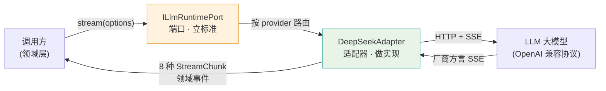
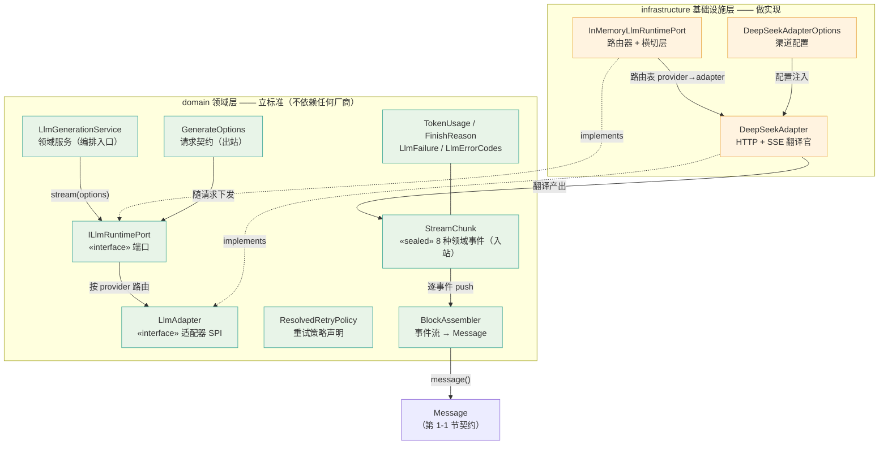

# 《DeepSeek Harness Java》第2-1节：LLM端口，最小DeepSeek适配器

作者：小傅哥
 博客：[https://bugstack.cn](https://bugstack.cn)
 视频：

>沉淀、分享、成长，让自己和他人都能有所收获！😄

大家好，我是技术UP主小傅哥。

`通信模型对象定了`、`SPI 插件规范写了`、`API 接口也设计了`，对应的模块也都提供了案例。那么接下来，我们将进入第二部分；“通电！”，提供智能体开发中最基本的根的部分 LLM 大模型对接。

为了让 LLM 大模型通信的对接具备不错的扩展性，适合于后续各类 LLM 厂商（OpenAI、Anthropic、Ollama）服务协议的迭代。这里我们要定义出对接标准，之后由基础设施层（）infrastructure 做适配实现。

>DDD 架构中的依赖倒置思想（老板定义标准，员工做具体实现），"端口-适配器" 的运用。

## 一、本章诉求

围绕智能体运行的最基本能力，接通 LLM 大模型；让领域层发起一次真实的对话请求，拿到流式返回，组装成第 1-1 节定义好的 `Message` 对象。

整个过程就办三件事🪿（走码上任）：

1. **立标准**：领域层定义端口 `ILlmRuntimePort` 和适配器 SPI `LlmAdapter`，声明"我需要一个会说领域事件语言的大模型"，但不依赖任何厂商。
2. **做实现**：infrastructure 层写出第一个适配器 `DeepSeekAdapter`，把请求翻译成 OpenAI 兼容的 HTTP 报文，再把厂商 SSE 返回（`delta.content`、`reasoning_content`、`tool_calls`、`usage`）翻译成 8 种 `StreamChunk` 领域事件。
3. **跑闭环**：一次"9.11 和 9.9 哪个大"的推理模型提问，从请求发出到事件流回来，最终由 `BlockAssembler` 组装出带思维链、文本、用量、结束原因的完整 `Message`，每一步都能用单测复现。

这样拆完之后，后续接入 OpenAI、Anthropic、Ollama 就只是新增一个适配器实现的事，领域代码一行不动。依然建议用 waliapi 本地 LLM Gateway 配合验证（下载地址在第 1-1 节），上下文里发了什么、返回了什么都能直接看到；本节适配器发出的就是标准 OpenAI 兼容报文，任何一家兼容服务都能直接对接。

## 二、流程设计

如图，是这一节的核心类结构关系。左边是领域层立的"标准"，右边是基础设施层做的"实现"，中间靠 `StreamChunk` 事件流把两边衔接起来。

对着图，把这套设计的几个关键点说清楚：

**① 两条契约线：出站认 `GenerateOptions`，入站认 `StreamChunk`**

调用方进来的只有一个请求对象 `GenerateOptions`（provider、model、messages、tools、温度、输出上限等字段），出去的只有一个事件流 `Flow.Publisher<StreamChunk>`。这一进一出就是端口对外暴露的全部——调用方既不需要知道底下是 DeepSeek 还是 Ollama。失败也不抛异常，统一转成流里的 `Finish(Error)` 事件，调用方永远用一套流式语义处理成功与失败。

**② 端口和适配器是两个契约，不是一个**

这是容易混的地方。`ILlmRuntimePort` 是给调用方用的（"我要发起模型调用"），`LlmAdapter` 是给实现方用的（"一个厂商适配器必须会做什么"）。两个接口分开后，中间的路由、重试、异常归一化这些横切能力就有一个天然的安放位置——端口的实现类 `InMemoryLlmRuntimePort`。它维护 provider → 适配器的路由表，并在路由之上做了三件"适配器不该各自重复做"的事：未注册 provider 的兜底创建、异常统一转 `Finish(Error)`、以及按 `ResolvedRetryPolicy` 做"未吐内容时可安全重建流"的重试（指数退避 + 抖动）。

**③ 适配器是翻译官，翻译方向是双向归一**

`DeepSeekAdapter` 干的活就是翻译：出站把 `Message`（内容块列表）和 `ToolSchema` 翻译成 OpenAI 兼容的 JSON 报文；入站把厂商 SSE 的 `delta.content` / `reasoning_content` / `tool_calls` / `usage` / `finish_reason` 翻译回 8 种 `StreamChunk` 领域事件。`StreamChunk` 用 sealed 接口封死事件的全部可能性，编译器强制所有消费方穷尽处理 8 种事件——后续新增事件类型时，所有遗漏处理的地方编译期就报错。

**④ 事件的终点是第 1-1 节的 `Message`**

`BlockAssembler` 是事件流的消费端：`push()` 逐事件累积（Start 登记新块 → Delta 追加内容 → End 冻结成品块），最后 `message()` 产出带内容块、usage、finishReason 的完整 `Message`。到这里，本节就与第 1-1 节定义的消息契约完全闭环了——前面定义的结构，在这一节被真正"填满"。

>整体看，这就是依赖倒置在模型接入上的完整落地：领域层用两个接口画出一个圈，圈内的代码不知道圈外是哪家厂商；圈外的适配器随便换、随便加，圈内的代码一行不动。

## 三、工程实现

### 1. 工程结构

	

