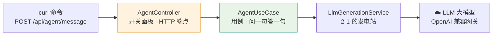
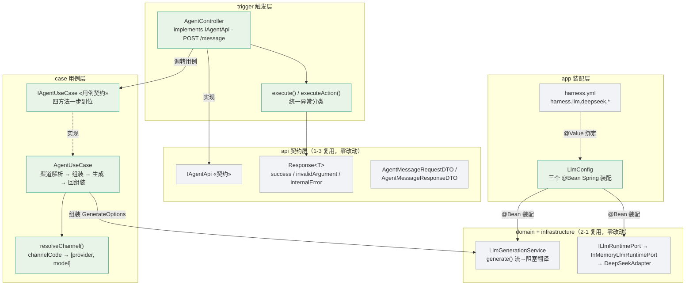

# 《DeepSeek Harness Java》第2-2节：最小对话HTTP入口

作者：小傅哥
 博客：[https://bugstack.cn](https://bugstack.cn)
 视频：[https://t.zsxq.com/H9Voc](https://t.zsxq.com/H9Voc)

>沉淀、分享、成长，让自己和他人都能有所收获！😄

大家好，我是技术UP主小傅哥。

先给个能用的，在提供好用的。在互联网应用开发中，经常以为敏捷开发模式进行增量迭代。我们开发的 dsh java 这个过程也类似，一圈一圈的给大家一个最基本的，之后在串联流程，再然后在流程上逐步迭代细分功能。

## 一、本章诉求

让 Agent 拥有一个最小可用的 HTTP 对话入口：外部发一条消息，Agent 回一句大模型的回答。形成一个最小闭环；

1. **Case 层串联流程**：`AgentUseCase` 实现"问一句答一句"的最小对话，把用户消息组装成 `GenerateOptions`，交给  `LlmGenerationService` 生成，再把结果组装回 `AgentMessageResponseDTO`；
2. **trigger 层接契约**：`AgentController` 实现第一部分定义的 `IAgentApi`，把 HTTP 请求转给用例，并统一做异常分类——调用方永远拿到结构化的 `Response`，而不是裸异常栈；
3. **app 层换装配**：上一级手工装配（`LlmCliProbe` 里一行行 `new`）换为 Spring `@Configuration` 装配，配置项从 `harness.yml` 经 `@Value` 注入。

本节先**只做阻塞式对话**，SSE 流式入口留给后续章节，会话持久化、Agent 创建、工具编排等。

>建议用 [waliapi](https://github.com/fuzhengwei/WaLiAPI/releases) 本地 LLM Gateway 配合验证，本节的对话流量都能在网关里看到。

## 二、流程设计

如图，是这一节的核心链路。上面三层是本节新写的（绿色），下面两层是 2-1 的成果原样复用（灰色）——注意看，本节所有新代码都"压"在 2-1 的抽象之上，领域层不用动。

- 通过 API 层定义的门面类 `AgentApi` 在 trigger 层实现接口，之后调用 `IAgentUseCase`  封装对 `LlmGenerationService` 领域层服务的使用。
- `AgentUseCase` 的能力，包括；组装 `GenerateOptions`、调 `generate().join()`、拼响应 Map。case 因为有了 domain 领域层服务的实现，它就会变得很轻，主要是串联的事。
- 配置驱动的装配：`harness.yml` → `@Value` → `@Bean` 用于驱动模型的配置使用。

>整体看，本节是"契约定义（1-3）→ 能力建设（2-1）→ 契约兑现（2-2）" 三个步骤把最小闭环串联起来。
