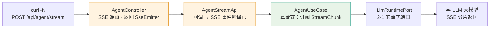
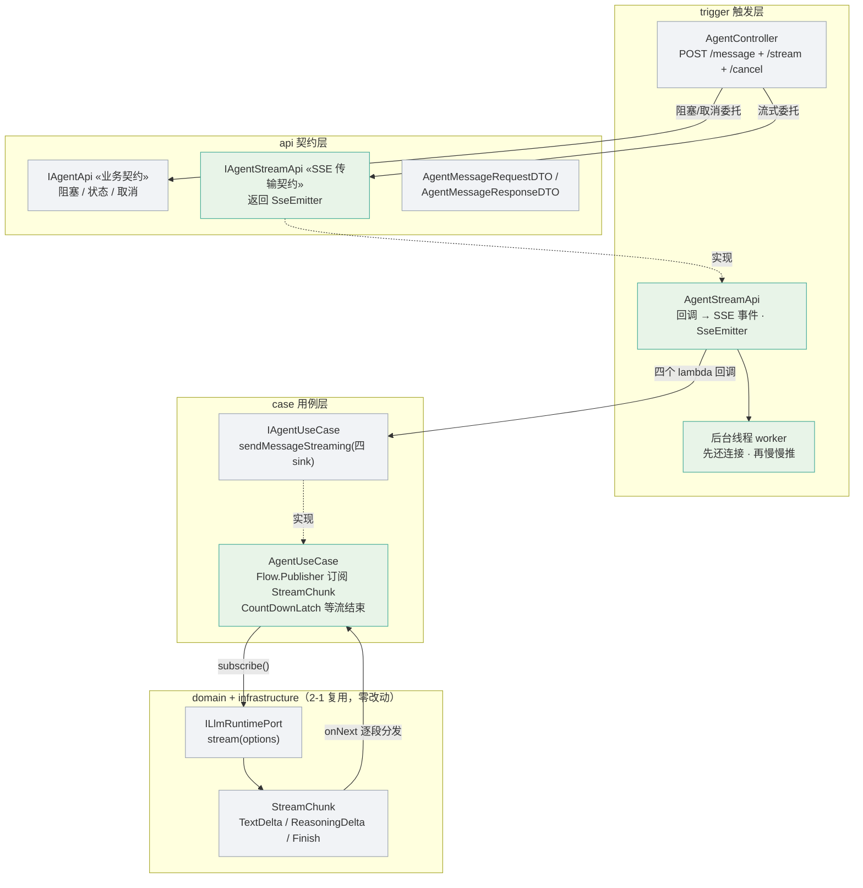

# 《DeepSeek Harness Java》第2-3节：最小SSE流式对话

作者：小傅哥
 博客：[https://bugstack.cn](https://bugstack.cn)
 视频：[https://t.zsxq.com/SIDoa](https://t.zsxq.com/SIDoa)

>沉淀、分享、成长，让自己和他人都能有所收获！😄

大家好，我是技术UP主小傅哥。

## 一、本章诉求

`做流式请求接口的最小实现`；我们所使用到的大部分 AI Agent 工具软件，对话过程中都是渐进式的把过程中的信息逐步展示给用户，这样可以避免用户傻等，也能有一个不错的体验。

让 Agent 的对话支持流式输出：请求发出后，模型每生成一小段内容，前端立刻收到一条 SSE 事件，最终回答逐字呈现；流结束后再补一条完整聚合消息供校验。

1. **api 契约层补口子**：使用 `IAgentStreamApi`（SSE 传输契约）定义，业务契约 `IAgentApi` 管"答什么"，传输契约管"怎么送"，两份契约各司其职；
2. **case 层换真流式**：`AgentUseCase.sendMessageStreaming()` 从"阻塞兜底、全文一次推"替换为 `Flow.Publisher` 订阅——每到一个 `StreamChunk` 增量就调对应 sink，模型逐 token 的回调原样透传出去；
3. **trigger 层做翻译**：新增 `AgentStreamApi`，把四个回调（delta / reasoning / toolcall / finish）映射为四种 SSE 事件名，由 `SseEmitter` 推给前端；`AgentController` 从"直接实现 IAgentApi"调整为注入两个门面，新增 `/stream` 端点。

会话持久化、Agent 状态机（running/finished）、工具调用编排依旧不在本节范围——先让流跑起来。

>推荐使用 [waliapi](https://github.com/fuzhengwei/WaLiAPI/releases) 本地 LLM Gateway 配合验证，`curl -N` 的分片到达节奏，在网关侧能对上号。

## 二、流程设计

如图，整个从api 定义，到 case 实现，在到 trigger 触发器层的封装。

- 注意 Controller 的角色变化：2-2 时它直接 `implements IAgentApi`、自己持有用例；本节它退得更"薄"——**只做路由转发**，阻塞与取消委托 `AgentApi`，流式委托 `AgentStreamApi`。也为了后续章节处理服务共用的问题。

- 流式接口的返回值（`SseEmitter`）天生不属于"统一 Response 包装"的世界——它是另一种传输协议，硬塞进 `execute()` 的异常分类反而别扭，所以单独一份传输契约。

事件流设计如下；

| SSE 事件 | 载荷 | 触发时机 |
|---------|------|---------|
| `message.delta` | 正文增量片段 | 模型每吐一小段文本，一条一推 |
| `message.reasoning` | 思考过程增量 | 推理模型的思考输出 |
| `message.toolcall` | 工具调用事件 | 后续章节 Agent 调工具时 |
| `message.finish` | `[DONE]` | 本回合生成结束 |
| `message.done` | 完整聚合文本 | 用例返回后补发，供前端校验丢段 |

>前四个事件在"推"的过程中到达，`message.done` 在最后到达——前端拿它和收到的 delta 累加结果比对，一条不多一条不少，才算这一回合真的送完了。