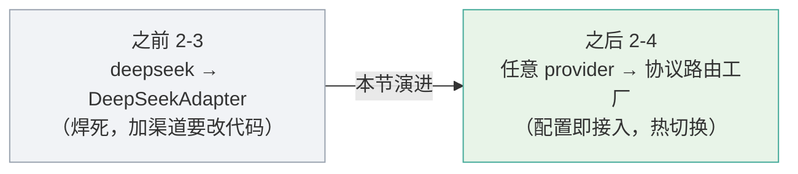
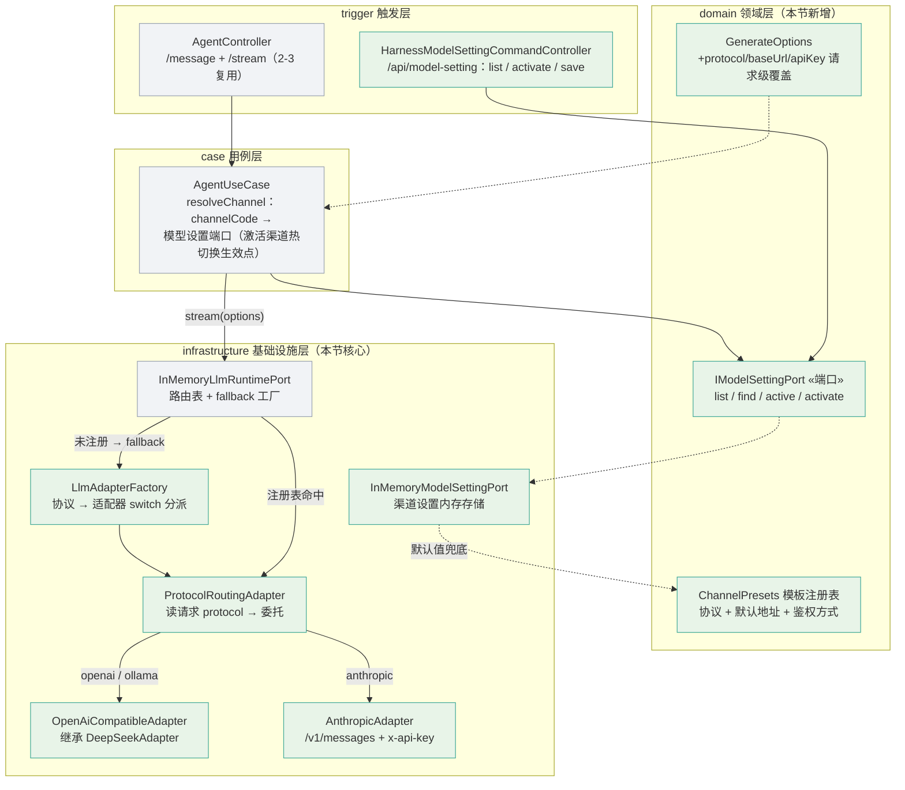

# 《DeepSeek Harness Java》第2-4节：适配器与协议路由工厂

作者：小傅哥
 博客：[https://bugstack.cn](https://bugstack.cn)
 视频：[https://t.zsxq.com/zIJo4](https://t.zsxq.com/zIJo4)

>沉淀、分享、成长，让自己和他人都能有所收获！😄

大家好，我是技术UP主小傅哥。

## 一、本章诉求

支持可动态切换的 LLM 渠道配置和使用，`让任意大模型渠道即插即用`；

之前章节里模型渠道是**焊死**的：启动时注册一个 `DeepSeekAdapter`，对话永远走这一个渠道。想加一个 Claude（Anthropic 协议）、接一个本地 Ollama？要么改代码重新注册 Bean，要么再写一个一模一样的适配器——厂商几十上百家家、标准协议就三种，这么写下去适配器会爆炸。

要解决的问题在这，以前是绑死的：

1. **渠道和适配器绑死**：路由表 `provider → adapter` 只认启动时注册的那一个；
2. **协议和适配器绑死**：`DeepSeekAdapter` 写死了 OpenAI 兼容协议的请求格式，而 Claude 走的是 Anthropic Messages 协议（`/v1/messages`、`x-api-key` 鉴权），根本不是一套报文。

本节要干掉是，把"协议"抽象出来：

- **协议只有三种**：openai（绝大多数厂商与网关兼容）、anthropic（Claude 的 Messages 协议）、ollama（本地协议，`/v1` 端点兼容 OpenAI）——厂商会不断冒出来，协议基本不会；
- **适配器按协议实现**：OpenAI 兼容家族一个类、Anthropic 一个类，两个实现覆盖全部协议；
- **渠道按配置声明**：一条渠道 = 渠道编码 + 协议 + 地址 + 密钥 + 模型，存进模型设置端口，运行时按协议路由。

最终形态：**新增一个渠道 = 保存一条配置，不改一行代码、不用重启**；Agent 编排、会话持久化依旧不动——本节只动"模型从哪来"这一层。

>推荐使用 [waliapi](https://github.com/fuzhengwei/WaLiAPI/releases) 本地 LLM Gateway 配合验证：它可以把一份 LLM 渠道，同时暴露 OpenAI 兼容与 Anthropic 两种协议端点，正好用来验证协议路由是否真的分派对了。

## 二、流程设计

这个目标拆到分层落地，就是"domain 补渠道契约、infrastructure 做协议路由、trigger 暴露管理入口"三层改动：

1. **domain 补渠道值对象族**：`ChannelProtocol`（协议枚举，未知值兜底 openai）、`AuthScheme`（鉴权方式：Bearer / x-api-key / 无）、`ChannelPreset + ChannelPresets`（十余家厂商的渠道模板注册表，地址/协议/推荐模型一站式预填）、`IModelSettingPort`（渠道设置端口：list / active / activate，存储实现可替换）；
2. **infrastructure 做协议路由**：`LlmAdapterFactory.createForProtocol()` 用 switch 表达式把协议编码分派到适配器实现；`ProtocolRoutingAdapter` 对外伪装成一个普通适配器，内部每次调用时读请求携带的 `protocol` 再委托；`OpenAiCompatibleAdapter` 继承 `DeepSeekAdapter` 零成本覆盖所有 OpenAI 兼容厂商；
3. **trigger 暴露管理接口**：`/api/model-setting/list` 查看渠道、`/{code}/activate` 激活（热切换生效点）、`/save` 保存渠道；对话请求的 `channelCode` 优先解析模型设置，不传则用激活渠道。

如图，渠道配置在 domain 添加值对象族与端口，协议路由落在 infrastructure，管理入口在 trigger。

设计思路：

- **为什么路由适配器叫"ProtocolRoutingAdapter"还要包一层工厂？** 端口 `ILlmRuntimePort` 的契约是"一个 provider 对应一个适配器"，但渠道的协议是**配置数据**不是代码——所以注册表里挂一个"路由壳"，真正的协议适配器推迟到每次调用时按请求里的 protocol 现场决定。新增渠道 = 新增一条配置，不是新增一个类。
- **为什么 `OpenAiCompatibleAdapter` 用继承而不是复制？** OpenAI 兼容协议的请求/响应格式各家完全一致，`DeepSeekAdapter` 已经实现了全部报文逻辑，子类只覆写 `providerId()` 身份——十几家厂商共享一份协议代码，这才是适配器的正确姿势。
- **为什么激活是热切换？** `InMemoryModelSettingPort` 里激活状态只是一个 `AtomicReference`，`activate()` 改一个引用，下一个对话请求立刻读到新渠道——模型设置是"读时解析"，不是"启动时绑定"。

协议分派规则一览：

| protocol | 适配器实现 | 报文特征 | 鉴权 |
|---------|-----------|---------|------|
| `openai`（含空值/未知值） | `OpenAiCompatibleAdapter` | `POST /chat/completions` | `Authorization: Bearer` |
| `anthropic` | `AnthropicAdapter` | `POST /v1/messages` + `anthropic-version` 头 | `x-api-key` |
| `ollama` | `OpenAiCompatibleAdapter` | `/v1` 端点兼容 OpenAI 协议 | 无（占位 key） |
