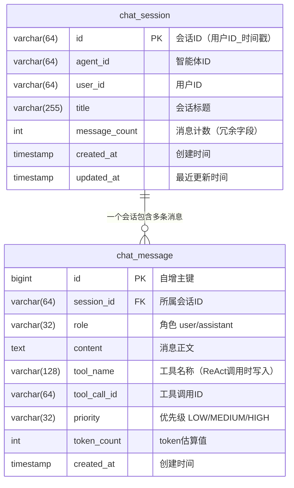

# 《WaLiCode - AI Coding 智能编码》第1-1节：持久化，会话消息表

作者：小傅哥
 博客：[https://bugstack.cn](https://bugstack.cn)
 项目：[https://t.zsxq.com/dt4QB](https://t.zsxq.com/dt4QB)

> 沉淀、分享、成长，让自己和他人都能有所知有所获！😄

大家好，我是技术UP主小傅哥。

## 一、本章诉求

在上一节架构设计分析以及整个产品体验的时候，我们看到客户端是可以配置和选择模型（LLM）的。而不只是使用配置到 agent yml 里的一个固定模型。

方便的配置和选择使用，是因为把 LLM 落到了库表里。这也是第一个我们最能直观的直接看到的，有数据库操作的。其实，除此之外，还有一些像是对话、记忆、SSH 链接等都会需要库表持久化存储。为此，我们这一部分（3个章节），就先把地基搭好，让各类的信息直接入库。

## 二、库表设计

库表这部分，会随着章节需要逐步添加。本次先围绕 AI 对话场景设计两张核心表：`chat_session`（会话表）记录每场对话的元数据，`chat_message`(消息表)记录会话中的每一条消息。二者是一对多的关系——一个会话包含多条消息。整体 ER 关系如下：

**会话表 chat_session**：记录用户与智能体每场对话的元数据。主键 `id` 由"用户ID_时间戳"拼出（如 `u001_1790743362762`），天然携带归属信息且避免自增 ID 外泄；`message_count` 是一个冗余的计数字段，目的是查询会话列表时不用去 count 消息表，属于典型的空间换时间设计。

**消息表 chat_message**：记录每场会话中的用户/助手消息及工具调用记录。除了 `role` / `content` 这些基础字段，还预埋了三组为后续能力服务的字段：
- `tool_name` / `tool_call_id`：ReAct 工具调用时写入，完整记录工具调用链路，普通对话为空；
- `priority`（LOW/MEDIUM/HIGH）：上下文裁剪时按优先级丢弃消息，为后续上下文工程的 Token 预算控制预留；
- `token_count`：token 估算值，配合 priority 做上下文长度控制。

`session_id` 上建了索引 `idx_chat_message_session`，支撑"按会话查最近 N 条消息"这一最高频的查询路径。
