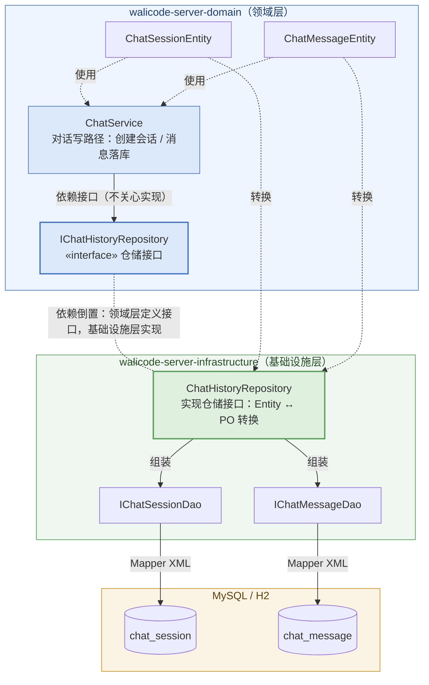

# 《WaLiCode - AI Coding 智能编码》第1-2节：持久化，对话落库

作者：小傅哥
 博客：[https://bugstack.cn](https://bugstack.cn)
 项目：[https://t.zsxq.com/dt4QB](https://t.zsxq.com/dt4QB)

> 沉淀、分享、成长，让自己和他人都能有所知有所获！😄

大家好，我是技术UP主小傅哥。

整个编码的课程节奏会慢一些，通过前面的基础内容，把整个工程了解到位。方便小伙伴理解透彻。否则可能会工程没理解，就有大量的代码了。

## 一、本章诉求

上一节我们把 `chat_session`（会话表）和 `chat_message`（消息表）两张表建好，也补齐了「PO → DAO → Mapper XML」的持久化操作线。之后我们把这部分的内容串起来，让对话消息可以持久化到数据库。那不存数据库会咋样？

- 服务一旦重启，用户的会话和聊天记录全部消失；
- 一个用户只对应一个固定会话，无法支持"开新对话"的多会话场景；
- 后续要做上下文工程（历史消息拼装、Token 预算控制），前提就是消息必须先落库。

为此，本节目标很明确：**让对话主链路的每次会话创建、每条消息收发，都可靠地写入数据库**。同时要守住分层边界——领域层不直接依赖 MyBatis 的 DAO 和 PO，而是通过仓储（Repository）接口解耦，由 infrastructure 层做适配。

## 二、流程设计

### 1. 整体视角

本节新增的内容集中在两条线上：

- **仓储线**：domain 层定义 `IChatHistoryRepository` 接口 + 两个实体（`ChatSessionEntity` / `ChatMessageEntity`），infrastructure 层给出 `ChatHistoryRepository` 实现，内部组合 1-1 已有的两个 DAO，负责 Entity ↔ PO 转换；
- **写路径改造线**：`ChatService` 拿掉内存 Map，会话创建改为"每次新建 + 落库"，消息收发在同步/流式两条路径上分别落库。

