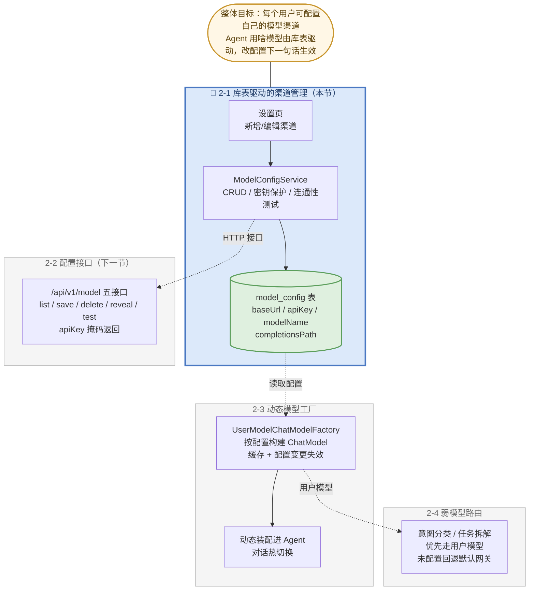

# 《WaLiCode - AI Coding 智能编码》第2-1节：模型配置，库表驱动的渠道管理设计

作者：小傅哥
 博客：[https://bugstack.cn](https://bugstack.cn)
 项目：[https://t.zsxq.com/AP5o2](https://t.zsxq.com/AP5o2)

> 沉淀、分享、成长，让自己和他人都能有所知有所获！😄

大家好，我是技术UP主小傅哥。

## 一、本章诉求

接下来，我们要进入第二阶段了。二阶段是 LLM 大模型的对接，这部分内容本身有 Spring AI 框架承担了。

但是这里有个小场景诉求，日常我们在使用各类 AI Agent 工具（Codex、Workbuddy、WaLiCode）都是可以自定义配置管理和使用模型的。所以这块在不局限于非得把配置写死到文件里，那么也要设计对应的库表，以及动态模型工厂来处理这部分内容。

## 二、流程设计

这里小傅哥先把二阶段的整体功能流程设计给大家，涵盖；库表配置、动态工厂、对话热切换，之后我们再分章节的逐步实现。

- 图中蓝色高亮的实线框就是**本节 2-1 要做的事**：新增 `model_config` 表，配上一个带密钥保护、参数规范化、连通性测试的领域服务。这部分是地基。
- 后面再把这套服务暴露成 HTTP 接口，以及动态模型工厂读取这份配置来构建 ChatModel，本节不做装配、以及对话链路，只是先搞清楚要干啥以及把最基础的地基出（库表）这部分处理好。
