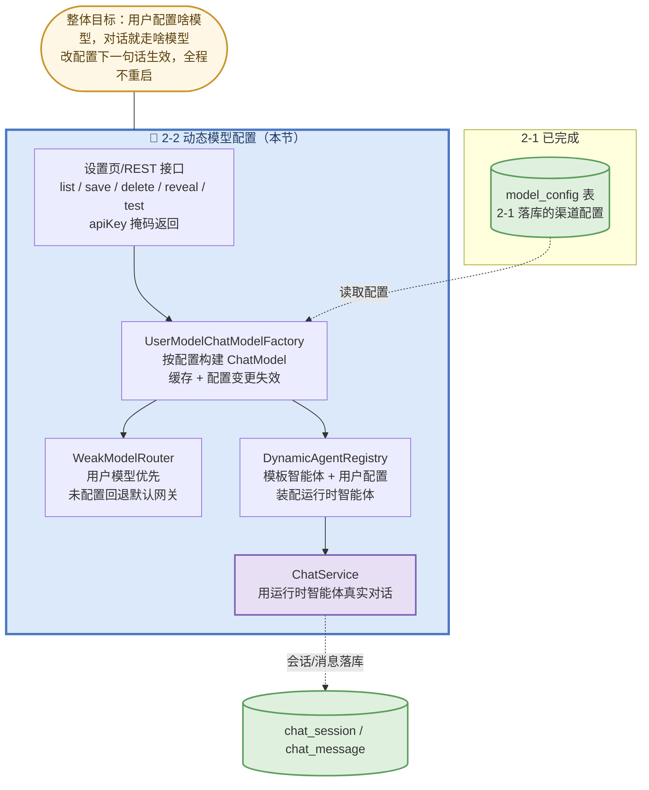

# 《WaLiCode - AI Coding 智能编码》第2-2节：动态模型配置切换

作者：小傅哥
 博客：[https://bugstack.cn](https://bugstack.cn)
 项目：[https://t.zsxq.com/COMTM](https://t.zsxq.com/COMTM)

> 沉淀、分享、成长，让自己和他人都能有所知有所获！😄

大家好，我是技术UP主小傅哥。

## 一、本章诉求

动态的模型切换分为2种，一个是直接去重写底层 Spring AI 使用的 HttpClient 客户端。直接替换 baseUrl、apiKey、model，另外一个就是本节实现的方式，在上层的 Model 实现动手，构建新的 Model 实例化。改造点；

1. **配置管起来**——增加一套服务接口，用于承载后续设置页的新增、编辑、删除、列表；同时 API Key 是敏感信息，列表返回必须掩码，不能明文出前端；
2. **配置用起来**——库里存的只是字符串（baseUrl/apiKey/modelName），Spring AI 认的是 `ChatModel` 对象，中间要有个工厂完成"配置 → ChatModel"的构建，并且配置变更后旧实例要立刻失效重建，不能一直用缓存的旧模型；
3. **对话切过去**——模板智能体的模型还写死在 agent.yml 里，要把用户配置动态装配进智能体，让对话主链路真正用上用户模型。

## 二、流程设计

如图，整体动态模型链路：

- 图中蓝色高亮的实线框是**本节要做的四件事**：REST 接口、用户模型工厂、弱模型路由、运行时智能体注册。
- 绿色的是 2-1 已就绪的库表和第 1 篇就有的对话持久化，本节直接复用。
- 紫色高亮 `ChatService` 是验证链路的终点——本节最后会用一次**真实对话**证明：用户配置的模型真的被用上了。

这里有两个概念容易混淆，先区分清楚：

| | 用途 | 谁消费 | 举例 |
|---|---|---|---|
| **弱模型**（可选设计，可以用于后续扩展 jev 模型） | 意图分类、任务拆解这类"幕后辅助调用" | `WeakModelRouter` | 后台悄悄判断你这句话想干啥 |
| **主对话模型** | 你看到的每一轮对话本体 | `DynamicAgentRegistry` | 你发"你好"，回复你的那个模型 |
